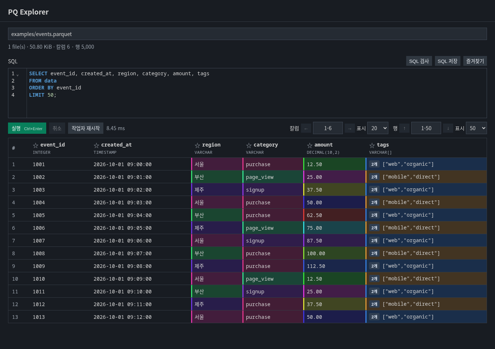

# PQ Explorer

Parquet·CSV·TSV·SBDF·XLSX 파일을 VS Code에서 열고 SQL로 탐색하세요. DuckDB가 확장에 포함되어 있어 Python·uv·Node.js를 따로 설치할 필요가 없습니다.



*화면은 공개용 예제 데이터로 구성한 PQ Explorer Webview입니다.*

## 주요 기능

- 지원하는 데이터 파일을 열면 SQL 편집기와 표를 바로 표시합니다.
- 파일 또는 데이터셋 폴더 경로를 입력하고 `Ctrl+Enter`로 실행합니다.
- 기본 50행·20칼럼씩 조회하며 행·칼럼 이동과 칼럼 고정을 지원합니다.
- LIST·STRUCT·BLOB을 표시하고, 큰 중첩 값은 원소 수와 미리보기로 제한합니다.
- 반복 값에 배경색을 적용해 현재 페이지의 패턴을 확인할 수 있습니다.
- 첫 페이지 표시 후 Parquet 푸터에서 원본 행 수를 읽어 갱신합니다.
- SQL 즐겨찾기 저장·검색·고정·정렬을 지원합니다.
- DuckDB SQL 검사, 실행 취소, 시간 제한, 작업자 재시작을 제공합니다.

## 시작하기

1. 확장 목록에서 **PQ Explorer**를 설치합니다.
2. 탐색기에서 `.parquet`·`.pq`·`.csv`·`.tsv`·`.sbdf`·`.xlsx` 파일을 엽니다. 다른 편집기로 열리면 **Reopen Editor With... → PQ Explorer**를 선택하세요.
3. SQL을 작성하고 **실행** 또는 `Ctrl+Enter`를 누릅니다.

```sql
SELECT *
FROM data
LIMIT 50;
```

데이터셋 폴더는 **PQ Explorer: Open Data File** 명령으로 선택합니다. 상단 경로를 바꾸고 실행하면 새 소스를 검증한 뒤 조회합니다. 잘못된 경로는 기존 SQL과 결과를 유지합니다.

`data`는 선택한 원본을 가리키는 읽기 전용 뷰입니다. `DESCRIBE SELECT * FROM data`로 칼럼과 타입을 확인할 수 있습니다. 상단의 원본 행 수는 SQL 필터 적용 전 수치이며, 정확한 SQL 결과 행 수 계산은 별도 설정입니다.

## 지원 파일 형식

| 형식 | 읽기 동작 |
| --- | --- |
| Parquet (`.parquet`·`.pq`) | 파일 또는 재귀 dataset 폴더. 첫 페이지 이후 푸터에서 원본 행 수 갱신 |
| CSV·TSV | UTF-8(BOM 포함). DuckDB가 헤더·타입·구분자를 감지하며 TSV는 탭 사용 |
| SBDF | SBDF 1.0의 plain·RLE·bit 인코딩. NULL·문자열·수치·날짜·시간·Binary 표시 |
| XLSX | 첫 행을 헤더로 사용. 상단 시트 선택 후 **실행**으로 변경 |

`.pq`는 실제 내용이 Parquet인 파일을 지원합니다. `.parquet`와 `.pq`가 섞인 dataset 폴더도 함께 읽습니다.

모든 형식은 `SELECT * FROM data`로 조회하며 필터·정렬·집계·즐겨찾기를 공통으로 사용할 수 있습니다. 폴더 열기는 Parquet dataset만 지원합니다. SBDF·XLSX는 최초 열기 시 선택한 데이터를 DuckDB 메모리 테이블에 읽어 들이므로 큰 파일은 준비 시간이 필요합니다. 원본은 수정하지 않습니다.

SBDF Decimal은 정밀도와 지수 범위를 보존하는 문자열입니다. SQL 계산 시 필요한 `DECIMAL` 타입으로 명시적으로 변환하세요. Spotfire 서식·분류·칼럼 설명 메타데이터는 표에 재현하지 않습니다.

XLSX는 기본 첫 시트를 표시합니다. 빈 헤더는 `column_1`처럼 채우고 중복 헤더에는 번호를 붙입니다. 날짜는 타임스탬프, 수치·Boolean은 해당 타입으로 가져오며 혼합 타입과 안전 정수 범위를 넘는 정수는 문자열로 보존합니다. 수식은 Excel이 저장한 계산 결과를 읽으며 재계산하지 않습니다. 계산 결과가 없는 수식은 빈 셀로 표시합니다. `.xls`·매크로·암호화 파일은 지원하지 않습니다.

XLSX의 상한은 파일 32 MiB·압축 해제 합계 64 MiB·시트당 100,000행(헤더 포함)·10,000칼럼·2,000,000셀입니다. SBDF는 slice당 최대 1,000,000행·2,000,000셀·128 MiB를 처리하며 단일 문자열·Binary 블록은 64 MiB까지 허용합니다. 상한을 넘으면 오류를 표시합니다.

## SQL 즐겨찾기

**SQL 저장**에서 별칭과 설명을 입력하고 **즐겨찾기**에서 다시 불러옵니다. 별표로 항목을 고정하고 실행 횟수·최근 사용·최근 수정·별칭 순으로 정렬할 수 있습니다. 최대 100개를 저장합니다.

즐겨찾기는 확장 전역 저장소에 저장됩니다. 즐겨찾기 창의 백업 폴더 경로 복사 버튼으로 위치를 확인할 수 있습니다. Remote SSH·WSL에서는 확장이 실행되는 원격 환경에 저장됩니다.

## 설정

| 설정 | 기본값 | 설명 |
| --- | --- | --- |
| `pqExplorer.queryTimeoutSeconds` | `30` | 조회 제한 시간(초). `0`이면 제한 없음 |
| `pqExplorer.exactResultCount` | `false` | SQL 결과 전체 행 수를 추가 계산 |
| `pqExplorer.duckdbMemoryLimit` | `2GB` | DuckDB 메모리 제한 |
| `pqExplorer.duckdbThreads` | `2` | DuckDB 스레드 수 |
| `pqExplorer.duckdbTempDirectory` | 빈 값 | workspace 내부 임시 폴더 |
| `pqExplorer.duckdbMaxTempSize` | `10GB` | 임시 디스크 사용 제한 |
| `pqExplorer.maxCellBytes` | `65536` | 중첩 값·BLOB 셀의 전송 상한 |

안전 정수 범위를 벗어난 정수와 DECIMAL은 정밀도를 보존하기 위해 문자열로 표시합니다.

## 지원 환경과 데이터 처리

Windows x64와 Linux x64의 VS Code 1.90 이상을 대상으로 합니다. Remote SSH·WSL에서는 workspace가 있는 환경에서 실행됩니다. macOS·ARM과 브라우저 전용 VS Code용 패키지는 이번 배포에 포함하지 않습니다. Windows 네이티브 패키지 구성은 검사했으나 Windows VS Code에서의 직접 실행 검증은 아직 완료하지 않았습니다.

신뢰된 workspace에서만 실행하며, 선택한 소스 범위의 파일과 단일 읽기 전용 SQL을 허용합니다. 파일 내용·SQL·조회 결과를 외부로 전송하는 기능이나 텔레메트리는 포함하지 않습니다. DuckDB 제한은 별도 운영체제 샌드박스가 아니며, 신뢰할 수 없는 파일에 대한 완전한 격리를 제공하지 않습니다.

## 문의

오류를 제보할 때는 운영체제·VS Code 버전·확장 버전과 재현 가능한 최소 SQL을 포함해 주세요. 데이터 파일이나 계정 정보 없이 재현할 수 있는 예제를 권장합니다.

## 라이선스

MIT License.
